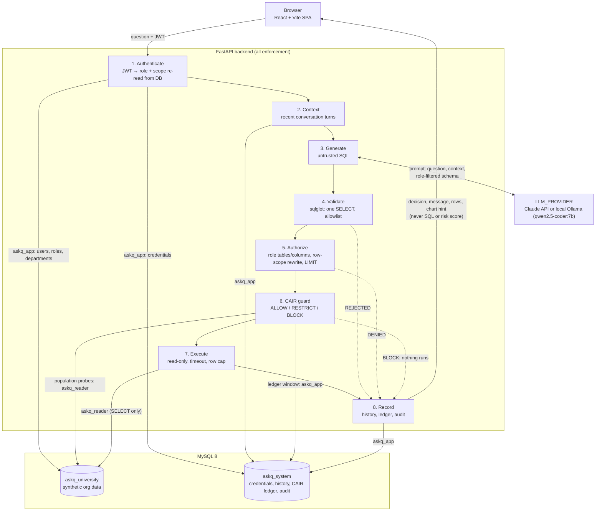

# ASKQ architecture

ASKQ (Ask Questions to your Data) turns natural-language questions into SQL,
and runs a query only after it passes validation, role-based authorization and
CAIR (Conversation-Aware Inference Risk) analysis.

## Components

| Component | Technology | Responsibility |
|---|---|---|
| Frontend | React 19 + Vite + TypeScript | Presentation only; never makes security decisions ([below](#frontend-phase-6)) |
| Backend | Python 3.13 + FastAPI | Authentication, pipeline orchestration, all enforcement |
| LLM | Claude API, or a local Ollama model (`qwen2.5-coder:7b`), chosen by `LLM_PROVIDER` | Translates questions into candidate SQL (treated as **untrusted**, whichever provider) |
| SQL safety | sqlglot | Parses SQL to an AST; enforces single read-only SELECT |
| RBAC | Backend policy module | Table/column/aggregate checks; server-side row-scope rewriting |
| CAIR | `backend/app/cair` | Population probes + per-user knowledge ledger + six inference audits → ALLOW / RESTRICT / BLOCK ([cair.md](cair.md)) |
| Database | MySQL 8 | `askq_university` (org data), `askq_system` (history, ledger, eval) |

## Request pipeline

All steps are implemented:
- Steps 1–5 and 7–8 in Phase 4 (see `backend/README.md`, "Query pipeline").
- Step 6, CAIR, in Phase 5 (see [cair.md](cair.md)).

Step 5 has two tiers:
- **RECORD:** the Phase 4 row scope; a user reads individual rows.
- **STATISTICAL:** university-wide, aggregate-only, and at least k people behind
  every statistic. Offered only while CAIR is enabled.



The same pipeline as text:

```
Browser ──JSON + JWT──► FastAPI
  1. Authenticate      verify JWT → user id, role, department/student/teacher scope
  2. Context           load recent conversation turns
  3. Generate          LLM (Claude / Ollama): question + context + schema visible to this role → SQL text
  4. Validate          tokens (no comments / ';'); parse; exactly one SELECT; node
                       and function allowlist; catalog tables only; row LIMIT
  5. Authorize         every table/column/aggregate checked against role policy;
                       row-scope predicates injected server-side
  6. CAIR              descriptor from the *rewritten* AST vs. user's ledger
                       → risk score + reasons → ALLOW / RESTRICT / BLOCK
  7. Execute           SELECT-only DB account, statement timeout
  8. Record            ledger update, query history, security audit
  ◄── {decision, message, columns, rows, chart hint, high-level security summary}
       (never SQL, risk score or reason codes: they stay in query_history)
```

## Security principles

- **LLM output is never trusted.** It is parsed, validated, authorised and rewritten before execution.
- **Defence in depth.** Even if validation had a bug, the `askq_reader` MySQL
  account has SELECT privilege only on `askq_university`.
- **Backend-only enforcement.** Frontend route guards exist for usability, not security.
- **Context supplies meaning, never permission.** Every follow-up question is
  re-authorised and re-audited from scratch.
- **Row scope is enforced by rewriting, not by asking.** Each scoped table is
  replaced with a derived table limited to the user's rows and visible columns,
  so no predicate the model writes can widen what a query sees.
- **Deterministic, explainable CAIR.** Descriptors come from the parsed SQL, and
  populations come from server-generated probes, never from the LLM, so the same
  query sequence always produces the same decision.
- **CAIR only narrows.** It runs after authorization; RESTRICT output is
  re-validated and re-authorized, and a BLOCK runs nothing. Refusals are uniform
  (same message and code whatever the cause), and CAIR's score and reasons are
  never returned to the client.
- **Honest limits.** CAIR is a heuristic risk detector, not a formal privacy guarantee.

## Frontend (Phase 6)

A single-page React app with no router or chart libraries (charts are plain SVG).

```
src/
├── api/        client.ts   one fetch wrapper: bearer token, error mapping, no cookies
│               validate.ts runtime checks for every response; copies known fields only
│               askq.ts     login, me, query, conversations, history
│               types.ts    what the UI may use (no SQL, no risk score)
├── auth/       session provider: user + in-memory token; 401 anywhere → back to login
├── components/ LoginPage, AppShell (sidebar, user and role, sign out), AskPage
│               (conversations + thread + composer), ResultCard, ResultTable,
│               Chart/chartSpec, HistoryPage, ProfilePage, Status (badges, loading, errors)
└── format.ts   cell, date and label formatting
```

**Auth flow.** `POST /api/v1/auth/login` → the token is kept in a module variable
(never web storage or cookies) and sent as `Authorization: Bearer`. The role,
permissions and scope shown in the UI are the backend's `user` object; navigation
hides sections the user lacks permission for, but that is convenience only: every
endpoint enforces its own permission. Any 401 clears the session and returns to
the login page with a notice. Sign-out drops the token (JWTs are stateless: a
copied token stays valid until it expires, as before).

**Query flow.** The Ask page sends `{question, conversation_id?}` to
`POST /api/v1/query` and renders the backend's decision:

| Decision | UI |
|---|---|
| ALLOW | explanation, chart (if the hint fits the data), table, row count |
| RESTRICT | same, plus a fixed privacy notice; nothing about what was withheld |
| BLOCK / DENIED / REJECTED / FAILED | the backend's safe message only; no data |

Each answer has a collapsible "How ASKQ checked this" panel with the validation,
authorization and CAIR outcomes and the backend's user-facing reasons. The risk
score, SQL and internal codes are not in the API response at all (removed from
the backend schema in Phase 6), and the client's validator would drop them if
an older backend sent them. A chart is drawn only if the hint matches the data: numeric values, bar ≤ 30
bars, line ≥ 2 points, pie 2–8 non-negative slices, KPI exactly one value.
Otherwise only the table is shown.

**CAIR's position.** The frontend is outside the trust boundary: it cannot choose a
tier, population or decision, and a modified client gains nothing because
validation, authorization and CAIR all run on the server for every request.

**Conversations and history** come from three read-only endpoints (Phase 6),
always limited to the caller's own rows:

| Endpoint | Returns |
|---|---|
| `GET /api/v1/conversations` | active conversations: id, title, times, turn count |
| `GET /api/v1/conversations/{id}` | its turns: question, stored summary, decision (404 if not the caller's) |
| `GET /api/v1/history` | the caller's questions with decision and row count |

Past answers' rows are not stored (by design), so reopened conversations show each
turn's question, summary and outcome; asking again re-runs the full pipeline.
